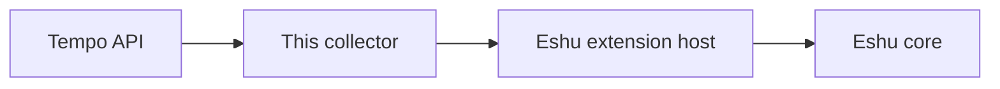

# eshu-collector-tempo

Status: pre-release. It isn't the live Tempo producer for Eshu yet, and Eshu core still owns admission and storage.

This collector peeks at a live Tempo target and tells Eshu which trace tags and services show up there, and whether the data still looks fresh. It reports back as facts, Eshu's small checked evidence records. Spans and trace payloads stay in Tempo where they belong.



In words: Tempo answers a few tag questions, this collector tidies the answers into facts, the host checks them, and core stores what's admitted. The host asks one claim at a time. If "claim" is new to you, read it as one bounded unit of work.

## Is this the tool you want?

Yes, if Eshu needs live evidence about trace tag coverage, like which services a Tempo target has actually seen lately.

No, if you're hoping to fetch traces for a person, run TraceQL searches, or stand in for Tempo. This collector reads tag metadata only, and it never writes to Tempo.

## Trying it in a minute

The host normally runs the binary, but a local smoke run takes one line with a recorded request:

```bash
go run ./cmd/collector < request.json > result.json
```

You'll get one result on stdout for the one request on stdin. For a real deployment, seed the release image and fill in an activation from `config.example.yaml`. [docs/guides/operations.md](docs/guides/operations.md) and [docs/reference/configuration.md](docs/reference/configuration.md) walk you through both.

## Docs, in reading order

| If you're… | Start with |
| --- | --- |
| curious how tags become facts | [docs/architecture/README.md](docs/architecture/README.md) |
| writing an activation file | [docs/reference/configuration.md](docs/reference/configuration.md) |
| deploying or debugging | [docs/guides/operations.md](docs/guides/operations.md) |

You'll also bump into [config.example.yaml](config.example.yaml), [manifest.yaml](manifest.yaml), and the [Dockerfile](Dockerfile) pretty quickly. That's expected.

## Sibling repos

- [eshu](https://github.com/eshu-hq/eshu): core, plus the extension host that runs this collector.
- [eshu-sdk](https://github.com/eshu-hq/eshu-sdk): the collector and fact-schema modules pinned here.
- [eshu-deploy](https://github.com/eshu-hq/eshu-deploy): deployment wiring for Eshu components.

## The short version of the contract

Tags in, fingerprints out. You'll learn which trace tags and services a Tempo target serves, without a single span or raw trace ID landing in a fact. If part of the read comes up short, the result says partial and tells you why. That's the whole deal, and it keeps trace evidence safe to store next to everything else Eshu knows.

Manifest version today is `0.1.3` for collector kind `tempo`.
Exact SDK pins and the release flow sit in [docs/guides/operations.md](docs/guides/operations.md).
If a fact kind ever changes, the manifest and [docs/architecture/README.md](docs/architecture/README.md) change together.

## Developing

Short version: `make ci` before you push. The longer version lives at the end of [docs/guides/operations.md](docs/guides/operations.md).

## Contributing, security, license

See [CONTRIBUTING.md](CONTRIBUTING.md) to contribute. You'll find no `SECURITY.md` and no `LICENSE` file in this repo. Source files carry an SPDX MIT header instead, so read the code as MIT.
